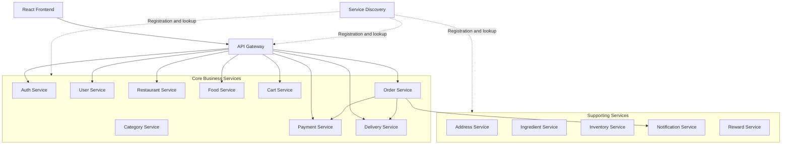

# 🍔 Food Delivery Platform — Distributed Microservices Architecture

<p align="center">
  <strong>A scalable, full-stack food delivery platform powered by Java, Spring Boot, React, and distributed systems technologies.</strong>
</p>

<p align="center">
  
  
  
  
  
  
</p>

## 📌 Overview

The **Food Delivery Platform** is a full-stack application designed around the core workflows of an online food ordering system. It separates business capabilities into backend services and provides a frontend for interacting with the platform.

The project explores microservices architecture, API-based communication, independent service responsibilities, containerization, database integration, and distributed application infrastructure.

The intended platform supports workflows such as browsing restaurants and food items, managing a cart, placing orders, processing payments, and coordinating delivery. The exact availability of each workflow depends on the implementation in the repository.

### 🎯 Project Objectives

- Build a modular backend using Spring Boot microservices.
- Separate business domains to improve maintainability.
- Provide a React-based user interface.
- Integrate relational databases and supporting infrastructure.
- Explore asynchronous messaging and distributed workflows.
- Containerize services for consistent development environments.
- Establish a foundation for testing, monitoring, and deployment.

## 🧩 Core Capabilities

| Domain | Responsibility |
|---|---|
| Identity and Access | Authentication and user access management |
| User Management | User profiles and account-related operations |
| Restaurant Management | Restaurant information and management |
| Food Catalogue | Food items, categories, and catalogue operations |
| Ingredients and Inventory | Ingredient data and inventory-related operations |
| Address Management | User delivery addresses |
| Cart Management | Shopping cart operations |
| Order Management | Order creation and lifecycle management |
| Payment | Payment-related operations and payment provider integration |
| Delivery | Delivery coordination and status management |
| Notifications | Notifications associated with application events |
| Rewards | Reward-related functionality |
| Discovery | Service registration and discovery |
| API Gateway | Central entry point for configured backend routes |

*These are domain-level responsibilities inferred from the service names and stated technology stack. Confirm the implemented endpoints and business logic in each service.*

## 🏛️ System Architecture

The project follows a microservices-oriented design in which separate backend services own distinct business responsibilities.



> **Architecture note:** This is a conceptual diagram, not a verified runtime dependency graph. The actual gateway routes, service-to-service calls, messaging paths, and discovery configuration should be checked against the source code.

### Architectural Principles

- **Separation of concerns:** Each service focuses on a specific business domain.
- **API-based integration:** Services can expose interfaces for other services or the frontend.
- **Independent deployment potential:** Services can be packaged and deployed separately when configured appropriately.
- **Infrastructure isolation:** Docker can provide reproducible development environments.
- **Distributed workflow awareness:** Cross-service business operations require careful handling of failures and consistency.
- **Security at service boundaries:** Authentication, authorization, and internal service access must be configured explicitly.

## 🔄 Example Business Workflows

The following workflows describe the intended business behavior. They should be treated as design examples until verified against the implementation.

### 1. Food Discovery

1. A user opens the frontend.
2. The frontend requests available restaurant or food information.
3. Requests are routed through the configured API Gateway.
4. The relevant service returns available catalogue information.
5. The frontend displays the response.

### 2. Order Placement

1. The user selects food items.
2. The cart records the selected items.
3. The user submits an order.
4. The order workflow validates the required information.
5. Payment processing is initiated if configured.
6. Order status is updated according to the implemented workflow.
7. Delivery and notification operations proceed where supported.

### 3. Asynchronous Processing

If Kafka is configured for business events, services can publish and consume events to reduce direct coupling. Event names, topics, delivery guarantees, retries, and dead-letter handling should be documented after confirming the actual implementation.

## 🛠️ Technology Stack

| Layer | Technologies |
|---|---|
| Backend | Java, Spring Boot |
| Frontend | React, JavaScript, Vite |
| API Layer | REST APIs, API Gateway |
| Service Discovery | Discovery Server |
| Relational Databases | MySQL, PostgreSQL |
| Caching | Redis |
| Messaging | Apache Kafka |
| Distributed Workflow Tools | Axon Framework / Axon Server, where configured |
| Payments | Stripe integration, where implemented |
| Containerization | Docker, Docker Compose |
| Orchestration | Kubernetes manifests |
| Build and Dependency Management | Maven, npm |
| Version Control | Git, GitHub |

The table lists technologies associated with the project. Check the actual configuration files to determine which are currently integrated, their versions, and their deployment status.

## 📁 Repository Structure

```text
food-delivery-app/
│
├── Backend/
│   ├── address-service/
│   ├── api-gateway/
│   ├── auth-service/
│   ├── cart-service/
│   ├── category-service/
│   ├── common-service/
│   ├── delivery-service/
│   ├── discovery-server/
│   ├── food-service/
│   ├── ingredient-service/
│   ├── init-db/
│   ├── inventory-service/
│   ├── notification-service/
│   ├── order-service/
│   ├── payment-service/
│   ├── restaurant-service/
│   ├── reward-service/
│   ├── user-service/
│   ├── k8s/
│   └── docker-compose.yml
│
├── Frontend/
│   ├── public/
│   ├── src/
│   ├── package.json
│   ├── package-lock.json
│   └── vite.config.js
│
└── README.md
```

The directory listing is representative. Adjust it if your current repository uses different folder names or contains additional services.

## ⚙️ Prerequisites

Install the tools required by your project configuration:

- Git
- Compatible JDK
- Maven or Maven Wrapper
- Node.js and npm
- Docker Desktop with Docker Compose
- Database and messaging infrastructure required by the selected services

Verify Java and Node.js versions against the project build files before installation.

## 🚀 Local Setup

### 1. Clone the repository

```bash
git clone https://github.com/vinaybarfa/food-delivery-app.git
cd food-delivery-app
```

### 2. Configure environment variables

Review the backend and frontend configuration files to identify the required settings.

Typical configuration categories include:

- Database connection details
- Database credentials
- Service ports and URLs
- JWT or identity-provider settings
- Kafka bootstrap servers
- Redis connection details
- Payment provider credentials
- Frontend API base URL

Use local environment variables or an untracked `.env` file where supported. If the repository provides an `.env.example`, use it as a template.

**Never commit real passwords, API keys, access tokens, or private credentials.**

### 3. Validate the Docker Compose configuration

Open a terminal in the backend directory:

```bash
cd Backend
docker compose config
```

Resolve missing variables and configuration errors before starting the application.

### 4. Start configured backend services

```bash
docker compose up --build
```

The services and infrastructure that start depend on the Compose configuration. Check the logs for successful startup and dependency connectivity.

### 5. Start the frontend

Open a separate terminal from the repository root:

```bash
cd Frontend
npm ci
npm run dev
```

Open the development URL displayed by Vite.

If the frontend cannot reach the backend, verify the API URL, gateway port, CORS configuration, and service health.

### 6. Stop the backend

From the `Backend` directory:

```bash
docker compose down
```

This stops the Compose-managed application. Persistent volumes may remain.

## 🧪 Testing and Quality

### Backend

Run tests for an individual service from its directory:

```bash
mvn test
```

If the service includes a Maven Wrapper on Windows:

```powershell
.\mvnw.cmd test
```

On Linux or macOS:

```bash
./mvnw test
```

Some integration tests may require databases, Kafka, Redis, or other dependencies.

### Frontend

List available npm scripts:

```bash
npm run
```

If the build script is configured:

```bash
npm run build
```

### Recommended Quality Checks

- Unit tests for business logic
- Integration tests for persistence and external dependencies
- API tests for request validation and error responses
- Authorization tests for protected operations
- End-to-end tests for critical ordering workflows
- Dependency and container image vulnerability scans
- Automated build and test checks in CI

These checks are recommendations unless already configured in the repository.

## 🔐 Security and Reliability

For a production-oriented deployment, review the following areas:

- **Authentication:** Validate identities and tokens correctly.
- **Authorization:** Enforce permissions for each business operation.
- **Secrets:** Store credentials outside source control.
- **Network security:** Restrict access to internal service and database ports.
- **Input validation:** Validate request payloads and handle invalid input safely.
- **Payment security:** Verify payment provider callbacks and never store sensitive card details unnecessarily.
- **Resilience:** Define timeouts, retries, and failure handling for remote calls.
- **Data consistency:** Define transaction boundaries and recovery behavior across services.
- **Observability:** Use structured logs, health checks, and metrics.
- **Dependency management:** Keep dependencies patched and scan for known vulnerabilities.

## 📈 Potential Future Enhancements

Possible improvements include:

- API documentation using OpenAPI
- Centralized logs, metrics, and distributed tracing
- CI/CD pipelines
- Automated integration testing with Testcontainers
- Database migrations and backup procedures
- Resilient asynchronous event processing
- Idempotent order and payment operations
- Outbox pattern for reliable event publication
- Saga orchestration or choreography for distributed transactions
- Rate limiting and stronger API protection
- Production-ready Kubernetes configuration
- Load testing and performance profiling

These are future improvement ideas, not claims that every capability is already implemented.

## 🐛 Troubleshooting

| Issue | Checks |
|---|---|
| Database connection error | Database status, host, port, credentials, and database name |
| Gateway returns an error | Route configuration, service availability, and target port |
| Service fails to start | Application logs, environment variables, and dependency availability |
| Kafka connection failure | Bootstrap server address, listener configuration, and network access |
| Redis connection failure | Redis status, connection settings, and container network |
| Frontend API request fails | API base URL, CORS settings, and backend availability |
| Maven build fails | JDK compatibility, dependency resolution, and the first meaningful error |
| Frontend build fails | Node.js compatibility, npm dependencies, and available scripts |

To inspect Compose logs:

```bash
docker compose logs
```

For a particular service:

```bash
docker compose logs <service-name>
```

## 🤝 Contributing

Contributions, bug reports, and improvements are welcome.

1. Fork the repository.
2. Create a feature branch.
3. Make focused changes.
4. Run relevant tests.
5. Commit your changes with a descriptive message.
6. Open a pull request explaining the change.

## 📄 License

A license has not been specified in this README. Add a `LICENSE` file if you want to define the permissions and restrictions for using and distributing this project.

## 👨‍💻 Author

**Vinay Barfa**

- GitHub: [@vinaybarfa](https://github.com/vinaybarfa)
- Repository: [Food Delivery App](https://github.com/vinaybarfa/food-delivery-app)

---

<p align="center">
  <strong>Built to explore full-stack development, microservices, and distributed application architecture.</strong>
</p>
